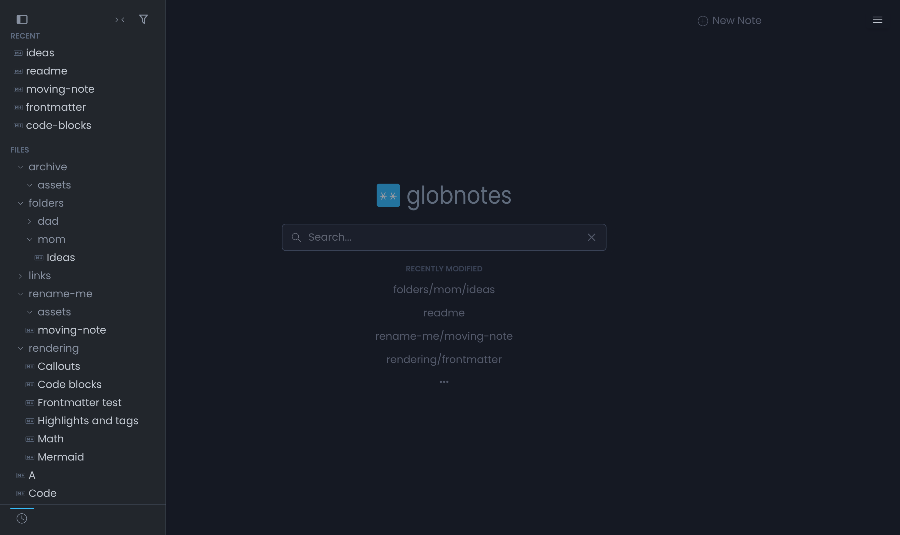

# 

A self-hosted, database-less note-taking web app built for Obsidian vaults and nested Markdown trees.

globnotes is a fork of [flatnotes](https://github.com/dullage/flatnotes) by Adam Dullage. flatnotes deliberately keeps every note in one flat directory; globnotes keeps its spirit (zero-config, single container, distraction-free) and adds support for notes in subdirectories. A note's relative path identifies it; its display title can come from its content.

<p align="center">
  
</p>

```
data/
├── dad/
│   ├── recipes/
│   │   └── soup.md        →  note at /dad/recipes/soup
│   └── assets/
│       └── broth.jpg      →  served at /dad/assets/broth.jpg
└── ideas.md               →  note at /ideas
```

## Obsidian-flavored support

globnotes renders the markdown features Obsidian users rely on — and the set grows over time.

**Supported today:**

- Wikilinks `[[wikilink]]` with `|alias` and `#heading` links
- Image and file embeds `![[image.png]]`, `![[doc.pdf]]`
- Callouts `> [!note]`, `> [!warning]`, …
- Hidden comments `%%comments%%`
- Highlight `==mark==`
- Mermaid diagrams
- YAML frontmatter (title, aliases, and more)
- KaTeX math
- Automatic URL linking

**Not yet (roadmap):** note transclusion (`![[Note]]`), block references/transclusion, task lists, footnotes, abbreviations/definition lists/emoji/sub/superscript, Dataview-style queries, and graph view.

## Why

Markdown is supposed to be app-independent. If your notes already live in folders — an Obsidian vault, a git repo, a Syncthing share — globnotes gives you a clean web view (and editor) over exactly that structure, without flattening anything. Mount whatever you like as subdirectories:

```yaml
volumes:
  - /srv/dad-notes:/data/dad
  - /srv/mom-notes:/data/mom
```

Folders are never "managed": creating `a/b/c` makes the directories, renaming `a/b` → `x/y` moves the file, and empty directories are pruned away (git-style).

### Plain HTTP homelabs

globnotes supports ordinary HTTP on a local domain such as
`http://globnotes.home/` or a LAN address. Viewing, creating, editing and saving
notes do not require a publicly registered domain, externally issued certificate,
HTTPS connection or browser secure-context exception. Resolve your local name to
the machine serving globnotes using your own local DNS or hosts mapping.

Internal UUIDs use one shared cryptographically random generator backed by
`crypto.getRandomValues()`, which browsers make available on plain HTTP. Plugins
can use the same contract through `ctx.createUuid()` or the browser
`@globnotes/plugin-sdk` export; see the [Plugin API](docs/plugin-api.md).

## Features

- **Real-path notes** — the URL path IS the vault path: `/dad/recipes/soup` is the note, `/dad/assets/broth.jpg` is its image. Relative links (``, `[x](../other.md)`) work exactly like in Obsidian — no rewriting, no magic.
- **Obsidian-flavored rendering** — `[[wiki-links]]` (with `|alias` and `#heading`), `![[image embeds]]`, `==highlights==`, `> [!callouts]`, `%%comments%%`, YAML frontmatter, mermaid diagrams, KaTeX math.
- **Sidebar folder tree** — Obsidian-style nested tree with expand/collapse, active-note highlight, filter textbox, and hover shortcuts to folder views.
- **Search modal** — one modal that jumps and searches: fuzzy-match a note by display title, alias, or path and open it, or take the pinned footer row into the full-text page. Matched characters are highlighted inline in the title/path of each row (filename hits outrank folder hits); top 10 results in a sticky footer'd list. top 9 results, every one with a `Ctrl/Cmd+N` shortcut; `Ctrl/Cmd+Enter` opens the full search with the query. Type `#` to complete tags; empty query shows this session's recently-opened notes.
- **16 theme choices** — System auto-detect plus light/dark variants of Globnotes, Catppuccin, Dracula, Gruvbox, Nord, Solarized and Tokyo Night. **Settings → Appearance** previews miniature notes grouped by family; System shows the default light/dark pair. Arrow keys move focus, Space/Enter applies without a page reload.
- **Full-text search and `#tags`** across the whole tree, scoped to a folder or recursive, with real-time filtering.
- **New-note flow** — `Untitled N` prefills in the current folder context; dead wiki-links offer a one-click "Create note" affordance.
- **Attachment-aware renames** — moving a note across folders prompts you to move its referenced files along too, or just fix the links.
- **First-run setup wizard** — no auth env vars? globnotes asks on first launch: set a password or explicitly disable auth. Each choice is deliberate.
- **Agent-friendly** — raw markdown and files over plain HTTP (see below).

## Versioned note backups

The shipped server plugin offers best-effort **post-change previous Markdown text**
history. Settings → Backups has a retention slider (default **2**, integer **1–10**)
and optional relative/absolute base. Newest is `Note.md.0.bak`; dedicated bases
mirror the captured original folder path. **Adjacent backups are visible vault
files: public readers can retrieve old or deleted text under normal serving policy.**
Note saves can succeed while backup delivery/storage fails. Histories are path-based;
changing bases does not migrate them. See the [plugin guide](plugins/globnotes-backup/README.md)
for environment pins, status, ownership/recovery and text/durability limits.

## Getting started

This development tree uses [v3 layered configuration](docs/configuration.md).
v3 is not released. Build this checkout before using the v3 examples below;
do not use a published `latest` image with this configuration. The current
runtime serves only `globnotes` and requires an existing notes directory.

```bash
docker build -t globnotes:v3-dev .
docker run -d \
  --name globnotes \
  -p 8080:8080 \
  -v /path/to/your/notes:/data/globnotes \
  globnotes:v3-dev
```

Open `http://localhost:8080` and complete the first-run setup: create a password, choose read-only (browse and search, no editing), or disable auth entirely (trusted networks only).

Or with docker compose from this checkout (create `./notes` first and run
`docker compose up -d --build`):

```yaml
services:
  globnotes:
    build: .
    image: globnotes:v3-dev
    container_name: globnotes
    restart: unless-stopped
    ports:
      - "8080:8080"
    volumes:
      - ./notes:/data/globnotes
      # Optional: keep application state outside the notes tree.
      # - ./state:/state
      # Optional: mount additional sources as subdirectories
      # - /srv/dad-notes:/data/globnotes/dad
      # - /srv/mom-notes:/data/globnotes/mom
    environment:
      # Enable together with the ./state mount above:
      # GLOBNOTES__METADATA_PATH: "/state"
      TZ: "UTC"
```

### Released v2 images (separate from this development tree)

Released images are published to [Docker Hub](https://hub.docker.com/r/alexindigo/globnotes)
(`alexindigo/globnotes`) and [GHCR](https://github.com/alexindigo/globnotes/pkgs/container/globnotes)
(`ghcr.io/alexindigo/globnotes`) with the same tags and content. For v2, select
`:v2` (or `:2`) and follow the README/configuration shipped with that release,
not the v3 examples on this page. An exact tag such as `:2.5.1` pins a release.

`latest` follows the numerically highest stable major. Once v3 ships, a later
v2 release updates `2` and `v2` without moving `latest` back. See
[releasing](docs/releasing.md) for tag details.

### v3: keep application state outside your notes

`GLOBNOTES__METADATA_PATH` selects a metadata base. Vault state lives at
`<metadata>/globnotes/`, and instance metadata at `<metadata>/_/`. Without it,
vault state lives at `<notes>/.globnotes/` and instance state at `<base>/.globnotes/`.

For a central Markdown repository shared with other editors, mount the existing
notes directory directly and give globnotes a separate persistent state mount:

```yaml
services:
  globnotes:
    build: .
    image: globnotes:v3-dev
    container_name: globnotes
    restart: unless-stopped
    ports:
      - "8080:8080"
    volumes:
      - /srv/notes:/data/globnotes
      - /srv/appdata/globnotes:/state
    environment:
      GLOBNOTES__METADATA_PATH: "/state"
```

Replace the host paths with your own directories. The left side of each mount is
a **host path**; the right side and both environment values are **container paths**.
In Unraid's container editor, the same setup is two path mappings (your notes to
`/data/globnotes`, application data to `/state`) and a variable named `GLOBNOTES__METADATA_PATH`
with value `/state`. `/index` is equally valid if that is your state mount's
container path; the directory name is not special.

| # | Content | Host location in this example |
|---|---|---|
| 1 | Markdown notes and attachments | `/srv/notes/` |
| 2 | Saved setup/access and vault settings | `/srv/appdata/globnotes/globnotes/config.json`, `config.toml` |
| 3 | Search index and SQLite companion files | `/srv/appdata/globnotes/globnotes/index.sqlite`, `index.sqlite-wal`, `index.sqlite-shm` |
| 4 | Custom branding files | `/srv/appdata/globnotes/globnotes/brand/` |
| 5 | Custom plugins and plugin policy | `/srv/appdata/globnotes/globnotes/plugins/`, `plugins.json` |

The value **is the metadata base**: `/state` means
`/state/globnotes/config.toml`, not `/state/config.toml`. State remains grouped
together; this setting does not provide independent directories for config and
the database. Keep it on a persistent mount so container recreation preserves
your settings. Environment-provided settings retain precedence over saved setup
choices.

Outside Docker, set `GLOBNOTES_GLOBNOTES_PATH` to the actual notes directory and
`GLOBNOTES__METADATA_PATH` to the actual metadata base. There is no
container-path translation in a native deployment.

The application user needs access to both directories and write permission for
state and any notes it edits. Container startup only adjusts ownership of the
selected state directory; it does not change ownership of the notes tree. Use
`PUID`/`PGID` when you need to select the application user's IDs explicitly.

#### Moving an existing installation

Changing `GLOBNOTES__METADATA_PATH` **does not move existing state automatically**.
Preserve the existing state rather than treating `.globnotes` as disposable cache:
it contains saved access configuration and other persistent application data.

| Step | Action |
|---|---|
| 1 | Stop globnotes before transferring state, so SQLite and configuration files are not changing during the copy. Back up the existing `.globnotes` directory. |
| 2 | For a v3 metadata relocation, copy its **entire contents**, including hidden files and SQLite companions, into an empty per-vault destination such as `/srv/appdata/globnotes/globnotes/`. Do not merge installations. v2 importing is separate future work, not a boot conversion. |
| 3 | Add the state mount, set `GLOBNOTES__METADATA_PATH` to its container base path, and ensure the application user can access the destination. Restart globnotes. |
| 4 | Confirm that the existing access configuration, branding, plugins, notes and search are present. Retain the original backup; remove the old vault-local state only after confirming the migration. |

Pointing at an empty state directory without copying the old configuration may
start the first-run setup wizard again. Startup never issues relocation hints,
converts old JSON, deletes legacy index files or performs the transfer.
Treat the state directory and its backups as sensitive: configuration can contain
authentication and signing material.

**Note backups are separate from core application state.** On versions with the
Versioned note backups plugin, `GLOBNOTES__METADATA_PATH` does not relocate its backup
files. The plugin defaults to backups beside notes and keeps recovery bookkeeping
in `<vault>/.globnotes-backup/`. Settings → Backups can select a separate backup
destination, but relocating core state alone does not move every plugin-created
file out of the vault.

### Shared vaults and symbolic links

To expose an existing central notes directory in Docker, bind-mount that directory
directly as `/data/globnotes`, as above. To expose several directories under one notes root,
use separate mounts such as `/srv/dad-notes:/data/globnotes/dad` and
`/srv/mom-notes:/data/globnotes/mom`. These are folders in one served tree, not separate
instances with independent access settings.

A symlink **inside** a mounted directory is resolved in the container's filesystem.
For example, a mounted `/data/shared` link pointing to `/srv/central-notes` does
not also expose the host's `/srv/central-notes`. Its target must exist at that path
inside the container. A direct bind mount makes the intended notes visible without
depending on that host-only symlink target.

The current folder tree and recursive note scanner **do not traverse symlinked
subdirectories inside the vault**. A symlink used as the configured vault root is
a different case: root path resolution does not categorically reject it, but this
is not a guarantee of complete symlink support across discovery, editing, renames
and attachment handling. Internal links and root links should not be treated as
interchangeable. If reporting a problem, describe the link's position and target
using placeholder paths, plus the relevant non-secret option names; do not paste
configuration files, credentials or tokens.

## URL model

| What | URL |
|---|---|
| Notes | `/dad/recipes/soup` — the whole root space |
| Vault files | `/dad/assets/broth.jpg` — same tree |
| App pages | `/_/login`, `/_/new`, `/_/search` |
| API, health, swagger | `/_/api/*` |
| Built assets | `/_/assets/*` |

The only reserved top-level segment is `_` — don't name a vault folder that. Everything else is yours.

`GLOBNOTES__SERVER_PATHPREFIX` is respected for multi-instance deployments: note
pages, files, API and assets live under the prefix; relative links keep working.

## Configuration

Shipped defaults, optional partial TOML, then env leaf overrides. Unknown names
and invalid types stop startup before service effects. See the complete commented
[`defaults/globnotes.toml`](defaults/globnotes.toml),
[`defaults/vault.toml`](defaults/vault.toml) and [configuration guide](docs/configuration.md).

| # | Variable | Default | Description |
|---|---|---|---|
| 1 | `GLOBNOTES__VAULTS_BASEPATH` | `/data` | Base folder; conventional notes at `<base>/globnotes` |
| 2 | `GLOBNOTES_GLOBNOTES_PATH` | conventional path | Explicit existing notes directory |
| 3 | `GLOBNOTES__METADATA_PATH` | empty | External metadata base, not the vault directory |
| 4 | `GLOBNOTES__SERVER_HOST`, `GLOBNOTES__SERVER_PORT` | `0.0.0.0`, `8080` | Bind address/port |
| 5 | `GLOBNOTES__SERVER_PATHPREFIX` | empty | Segment-exact URL prefix |
| 6 | `GLOBNOTES__SERVER_ALLOWEDHOSTS` | empty list | Comma-separated hosts, optional ports; other hosts get 421 |
| 7 | `GLOBNOTES__INDEX_BATCHSIZE`, `GLOBNOTES__INDEX_BATCHDELAY`, `GLOBNOTES__INDEX_SCANCACHETTL` | `200`, `0.1`, `15` | Batch count, delay and listing-cache seconds |
| 8 | `GLOBNOTES__HUB_SCANINTERVAL` | `60` | Periodic reconciliation seconds |
| 9 | `GLOBNOTES__PLUGINS_RENDERWORKERS` | `2` | Render workers per vault |
| 10 | `GLOBNOTES_GLOBNOTES_PLUGINS_AUTOENABLE` | `true` baseline | Explicit TOML/env pins override saved policy; defaults do not |
| 11 | `GLOBNOTES_GLOBNOTES_PLUGINS_SETTINGS` | `{}` | Addressed plugin JSON, validated by installed schemas |
| 12 | `GLOBNOTES__SESSIONS_EXPIRYDAYS` | `30` | Session lifetime days |
| 13 | `GLOBNOTES__MCP_ENABLED`, `GLOBNOTES__MCP_RATELIMIT` | `true`, `600` | Endpoint switch and tool calls/minute; 0 disables limiting |
| 14 | `GLOBNOTES__LOG_LEVEL` | `INFO` | Validated log level; `LOGLEVEL` is ignored |
| 15 | `GLOBNOTES_GLOBNOTES_QUICKACCESS_*` | shipped vault defaults | `HIDE`, `TITLE`, `TERM`, `SORT`, `LIMIT` |
| 16 | `GLOBNOTES_GLOBNOTES_BRAND_NAME`, `GLOBNOTES_GLOBNOTES_BRAND_ACCENT` | empty | Per-field branding pins, including explicit empty values |
| 17 | `GLOBNOTES_CONFIG` | `config/globnotes.toml` | Alternate instance TOML; explicitly missing files fail |
| 18 | `PUID`, `PGID`, `EXEC_TOOL` | launcher behavior | Retained launcher inputs, never app leaves; notes are not recursively chowned |

Old auth/credential/signing/read-only-settings env inputs are removed without
aliases. Setup/access retain their guarded private records during this local
transition; instance accounts, Admin permissions, registry and v2 import are
separate future pieces. See [MIGRATION.md](MIGRATION.md).

### Home network deployment

Public setup makes notes readable and writable to everyone on the network.
Read-only setup allows browsing without writes. Keep these modes on trusted
networks; configure `GLOBNOTES__SERVER_ALLOWEDHOSTS` to prevent DNS rebinding.
The server warns when public/read-only access has no host restriction.

### Access settings

**Settings → Access** updates the existing account in place. Leave the new-password
field blank to keep the current password hash. Adding an authenticator first
shows its enrolment QR; credentials and sessions remain unchanged until its new
code is confirmed. Protected access changes additionally require the current
password and current authenticator code when already enabled. A committed
password/2FA change invalidates old sessions and requires sign-in with the
confirmed credentials. Cancelling enrolment does not reset setup or the account.

The public-access panel's **Read-only settings** locks access/security, branding,
vault plugin policy/settings and operator permissions while retaining public note
editing and browser-local theme/keybinding/line-number/debug preferences. It
defaults off for initial public setup, on for a saved other-mode → public change,
and remains selectable before saving. Existing public deployments without the
option retain writable settings. Read-only note access still denies note writes.

Locked public settings cannot unlock themselves through the UI, API or legacy
setup/reset URL. For this transitional local record, recover by editing
`read_only_settings` in the metadata directory's private `config.json` and
restarting. Public/read-only modes provide no management-only login. This bridge
is not the final v3 identity or import format.

## Agent access

MCP clients (Claude Code, Codex CLI, Gemini CLI, opencode, Cursor, VS Code, Zed, Claude Desktop and others) can search, read and edit the vault through the built-in MCP endpoint: see [docs/mcp.md](docs/mcp.md) for each client's setup.

With token auth (or no auth at all), your notes are plain HTTP:

```bash
# Raw markdown
curl -H "Authorization: Bearer $TOKEN" https://notes.example/_/api/files/dad/recipes/soup.md

# Search (add folder=dad/recipes to scope to a subtree, nested=false for root-only,
# limit=20&offset=40 for one page)
curl -H "Authorization: Bearer $TOKEN" "https://notes.example/_/api/search?term=soup"

# Drop a file into a vault
curl -H "Authorization: Bearer $TOKEN" \
  -F "file=@photo.jpg" -F "directory=dad/recipes" \
  https://notes.example/_/api/files
```

## Migrating from v2 to v3

v3 is in development on `main`. It is a major release with breaking changes:
several vaults per instance, accounts with per-vault access, layered configuration
and new environment variable names. v2 stays available (image tag `2`) and keeps
receiving fixes. [MIGRATION.md](MIGRATION.md) describes what changes and the upgrade
steps; it is a draft until v3 is released.

## Plugins

Plugins can contribute rendering, server workflows and guards, browser/editor
extensions, commands, settings pages and sandboxed HTTP endpoints. The built-ins
(`globnotes-autolinks`, `-callout`, `-comments`, `-embeds`, `-mark`, `-mermaid`)
provide the Obsidian-flavored rendering; install your own under
`<state dir>/plugins/<id>/` (`<vault>/.globnotes` by default).

Open **Settings → Plugins** for inventory, enablement, auto-enable and permission
review in expandable plugin rows. A plugin's **Open settings** action and its
**Plugin settings** navigation entry open its declared pages as tabs; **Manage in
Plugins** returns to its expanded row. Vault policy owns server, browser and editor activation across browsers.
Pending or postponed access requests also appear under **Needs attention** at the
top of Settings navigation. Those entries open a decision layer over the current
page, preserving its tab and drafts without triggering page departure.
Legacy browser render preferences may suppress an already vault-enabled renderer
for a request; they cannot activate a vault-disabled plugin or stop server
workflows. Theme/keybindings remain browser preferences.

Server contributions run in permission-narrowed Deno Workers. Manifests request
network data and remote-code import access; effective rights also require the
per-plugin **Allow network** master, operator approval and parent authority.
Browser/editor code remains trusted same-origin code, and these server controls
do not restrict browser network loads from rendered content. Explicit legacy raw
filesystem grants remain a separate trust boundary. See the
[authoring guide](docs/plugins.md) and [Plugin API](docs/plugin-api.md).

## Event bus

Components communicate over a mitt-based client-side event bus — publishers announce facts like "note renamed" or "theme changed," consumers decide what to refresh. 59 topics cover note lifecycle, sidebar, menus and modals, edit sessions, themes, plugins, files, search, and the editor action channel (`editor:*` / `app:*`). See [docs/event-bus.md](docs/event-bus.md) for the topic registry and usage guide.

## Keybindings

Keyboard shortcuts are a **switchable layer** — **Settings → Keybindings** shows four named layers (**Obsidian**, **Notion**, **Typora**, **VS Code-lite**) plus a **Custom** layer, followed by the active layer's bindings. **Obsidian is the default**, including when a previously saved layer is no longer available.

- **Cross-layer constants:** `Ctrl+Alt+N` (new note) and `Ctrl+Alt+H` (home) work everywhere — every app's own new-note key is browser-reserved.
- **Save:** all layers use `Mod+S` with `Ctrl/Cmd+Enter` kept as an alias (`Mod` means Ctrl on Windows/Linux, Cmd on macOS).
- **Host commands:** Obsidian's `Mod+P` and VS Code-lite's `Mod+Shift+P` open the command palette, including registered plugin commands. Notion's slash-menu action remains unimplemented.
- **Both editors, one channel:** keys reach the editors as `editor:*` actions on the event bus, so source mode and WYSIWYG handle the same layer — formatting actions that WYSIWYG applies natively are applied in source mode as markdown-syntax edits (Typora-style). The layer also fixes latent keymap conflicts: `Mod+Enter` saves instead of inserting a blank line, `Mod+I` toggles italic, and Escape collapses a multi-cursor selection before exiting.
- **Custom layer:** starts as a copy of the default Obsidian layer; click any binding and press a new key to remap it (modified entries have a **Reset** action). Overrides are stored per-browser in `localStorage`, same as the theme choice.

## Branding

**Settings -> Branding** sets the name, accent and logo/icon. Name and accent
live in vault `config.toml`; image files live in `brand/` beside it. Metadata
relocation uses `GLOBNOTES__METADATA_PATH`, including the per-vault directory.

- The accent recolors the Globnotes Light/Dark themes; themes with a brand color of their own keep it.
- **Save branding** applies your choices; **Cancel changes** discards only Branding drafts and keeps Settings open. **Reset branding…** asks before clearing the vault's stored branding.
- The brand name replaces "globnotes" in the browser tab, the web manifest, and the navbar wordmark.
- A custom `icon.svg` doubles as the browser-tab favicon; drop dedicated favicon files to go further.

Favicon files are file-drop only — no dialog fields. Drop them into
`<state directory>/brand/`: `<vault>/.globnotes/brand/` by default, or
`/state/globnotes/brand/` when `GLOBNOTES__METADATA_PATH=/state`.

| File | Replaces |
|---|---|
| `favicon.ico` | the shortcut icon |
| `favicon-16x16.png` / `favicon-32x32.png` | tab favicons |
| `apple-touch-icon.png` | iOS home-screen icon |
| `safari-pinned-tab.svg` | Safari pinned tab |
| `site.webmanifest` | the PWA manifest (generated from the brand config when absent) |

`GLOBNOTES_GLOBNOTES_BRAND_NAME` / `GLOBNOTES_GLOBNOTES_BRAND_ACCENT` (`#rrggbb`)
pin individual fields. An unpinned sibling and images remain editable.

## Deferred / future work

See [FutureDevelopment.md](FutureDevelopment.md) — note transclusion, unresolved-link styling, backlinks/graph, compat hats, and more.

## Development

```bash
# Install everything (all dependencies resolve from deno.json)
deno install

# Server — tests, lint, type check
deno task test       # Server integration and unit tests
deno task lint
deno task check

# Client build & unit tests (via Deno npm compat — no npm/node required)
deno task build:client
deno task test:client
```

All checks, including the native browser suite, also run in a capped devcontainer; the commit hook and CI use it ([testing](docs/testing.md)).

## Credit

globnotes is a fork of [flatnotes](https://github.com/dullage/flatnotes) by Adam Dullage, who built the excellent foundation this project stands on. GNU Lesser General Public License v3.0 licensed (see [LICENSE](LICENSE)); upstream flatnotes code remains under the MIT License (see [THIRD-PARTY-NOTICES.md](THIRD-PARTY-NOTICES.md)). Full attribution for upstream, dependencies, and the community that shaped the design lives in [THIRD-PARTY-NOTICES.md](THIRD-PARTY-NOTICES.md).
